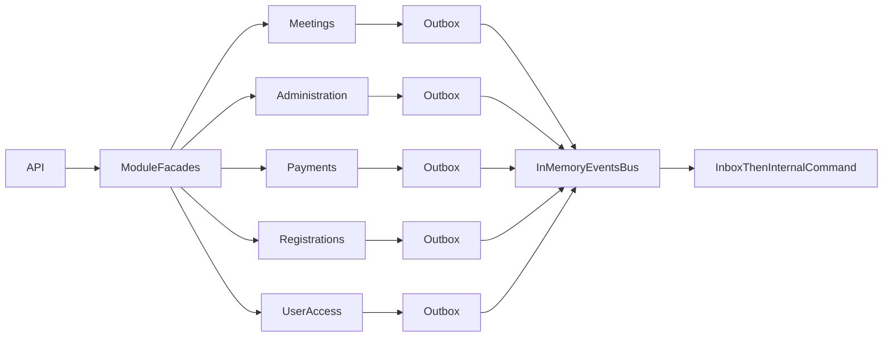

# پورت Modular Monolith with DDD به NestJS

منبع رفتار و مرزها: [kgrzybek/modular-monolith-with-ddd](https://github.com/kgrzybek/modular-monolith-with-ddd) (شاخه `master`). ریپوی فعلی خالی است. فرانت‌اند React جداگانه پورت نمی‌شود. قرارداد HTTP (مسیرها، permissionها، `POST /connect/token` با password grant، کاربران seed) حفظ می‌شود تا همان کلاینت بتواند وصل شود.

## تصمیم‌های ثابت

- یک پروسه NestJS 11. API نازک است و فقط احراز هویت، permission و واگذاری Command/Query را انجام می‌دهد.
- هر bounded context فقط از راه facade عمومی (`executeCommand` / `executeQuery`) و قرارداد Integration Event دیده می‌شود. تماس مستقیم متد بین ماژول‌ها ممنوع است.
- دامنه TypeScript خالص است (بدون decorator مربوط به ORM). منطق کسب‌وکار داخل aggregate می‌ماند.
- PostgreSQL 16. نوشتن با repository و تراکنش `pg` داخل Unit of Work. خواندن با SQL خام روی view، معادل Dapper.
- یکپارچگی ناهمگام: bus درون‌حافظه‌ای به‌علاوه جدول‌های Outbox و Inbox و InternalCommands در اسکیمای هر ماژول. پردازش پس‌زمینه با jobهای درون‌پروسه (معادل Quartz)، بدون Redis یا message broker.
- Payments همان ترکیب اصلی را نگه می‌دارد: aggregateهای event-sourced از راه Aggregate Store روی `payments.streams` / `payments.messages`، بقیه با repository. پروجکشن‌ها eventual consistent هستند.
- mediator سراسری `@nestjs/cqrs` استفاده نمی‌شود. هر ماژول mediator و composition root خودش را دارد تا handlerها به ماژول دیگر نشت نکنند.

نگاشت تکنولوژی: IdentityServer به JWT با `@nestjs/jwt`، Serilog به `nestjs-pino`، FluentValidation به کلاس Validator جدا برای هر Command، Problem Details به exception filter مطابق RFC 9457، DbUp به runner سبک SQL با ژورنال `app.migrations_journal`، NetArchTest به `dependency-cruiser`، NUnit به Jest.

## چیدمان ریپو

مونوریپوی Nest CLI، هم‌تراز assemblyهای اصلی:

- [apps/api](apps/api) — کنترلرها، guard مربوط به permission، فیلتر خطا، Swagger
- [src/building-blocks/domain](src/building-blocks/domain) — `Entity`, `ValueObject`, شناسهٔ تایپ‌شده، `BusinessRule`, `DomainEvent`
- [src/building-blocks/application](src/building-blocks/application) — `ICommand` / `IQuery`، mediator هر ماژول، دکوراتورهای logging و validation و unit of work، execution context
- [src/building-blocks/infrastructure](src/building-blocks/infrastructure) — `SqlConnectionFactory`, Unit of Work روی `AsyncLocalStorage`, Outbox/Inbox/InternalCommand processor, in-memory bus
- [src/modules/user-access](src/modules/user-access) و به همین شکل `registrations`, `administration`, `meetings`, `payments` — هر کدام `domain` / `application` / `infrastructure` / `integration-events`
- [database/migrations](database/migrations) — ترجمهٔ ساختار و migrationها و seed از `src/Database/CompanyName.MyMeetings.Database`
- [docker-compose.yml](docker-compose.yml) — `postgres`, migrator, api

اسکیماها: `app`, `users`, `registrations`, `administration`, `meetings`, `payments`. هر ماژول فقط اسکیمای خودش را می‌نویسد.

در زمان پیاده‌سازی، درخت C# فقط به‌عنوان مشخصات خوانده می‌شود و داخل این ریپو commit نمی‌شود. هر use case با همان اسم، قانون دامنه، event و شکل DTO منتقل می‌شود.

## رفتارهایی که باید عین اصل بمانند

- زنجیرهٔ Command: logging، سپس validation، سپس handler، سپس اگر فرمان داخلی است علامت‌گذاری processed، سپس dispatch کردن domain eventها در همان تراکنش، سپس commit. Integration eventها در همان commit داخل Outbox ذخیره می‌شوند.
- Outbox منتشر می‌کند، Inbox پیام را ذخیره می‌کند و فقط با Internal Command وضعیت ماژول مقصد را عوض می‌کند.
- Permission روی کنترلر چک می‌شود، نه Role. نام permissionها از `HasPermission`های C# کپی می‌شود.
- احراز هویت: `POST /connect/token` با `grant_type=password`, `client_id=ro.client`, `client_secret=secret`. کاربران seed: همان ایمیل و رمز نمونه (مثلاً `testMember@mail.com` / `testMemberPass`) با hash سازگار با bcrypt، چون hash مربوط به ASP.NET Identity قابل استفاده نیست.
- ایمیل واقعی ارسال نمی‌شود؛ مثل نمونه در `app.emails` ذخیره می‌شود.
- قوانین دامنهٔ Meetings (میزبانی فقط توسط عضو گروه پرداخت‌شده، محدودیت شرکت‌کننده، waitlist، RSVP، commenting) و جریان Administration (تأیید proposal و ساخت گروه) و Registrations (ثبت‌نام و تأیید ایمیل) و Payments (خرید اشتراک، تمدید، meeting fee، price list، انقضا) پیاده می‌شوند.

## ترتیب تحویل

شانزده تسک، به ترتیب وابستگی. هر تسک باید build شود و قبل از تسک بعدی تمام شود. تست واحد دامنه همراه همان تسک ماژول نوشته می‌شود؛ تسک ۱۶ مجموعهٔ یکپارچه، قانون معماری، و مسیر اجرای کامل را می‌بندد.

پایه:

- تسک ۱ — اسکلت NestJS، پیکربندی، لاگ، Swagger، Problem Details، Postgres در Docker.
- تسک ۲ — بلوک‌های دامنه در [src/building-blocks/domain](src/building-blocks/domain).
- تسک ۳ — mediator هر ماژول و سه دکوراتور Command.
- تسک ۴ — Unit of Work، Outbox، Inbox، InternalCommand، bus، job پردازنده، جدول ایمیل.
- تسک ۵ — ترجمهٔ SQL به PostgreSQL و runner مهاجرت.

برش‌های عمودی:

- تسک ۶ — User Access و `POST /connect/token`.
- تسک ۷ — Registrations تا ساخت کاربر از راه integration event.
- تسک ۸ — Administration: پیشنهاد گروه و تأیید آن.
- تسک ۹ — گروه‌های Meetings: پیشنهاد، عضویت، ترک.
- تسک ۱۰ — جلسه‌های Meetings: شرکت، waitlist، میزبان، RSVP.
- تسک ۱۱ — نظر و لایک Meetings، و کنترلرهای باقی‌مانده.
- تسک ۱۲ — بخش جدولی Payments: payer، price list، meeting fee.
- تسک ۱۳ — event store و اشتراک‌های event-sourced.
- تسک ۱۴ — پروجکشن `SubscriptionDetails` و API پرداخت.
- تسک ۱۵ — سیم‌کشی eventهای بین‌ماژولی که در تسک‌های قبلی فقط قراردادشان ساخته شده.
- تسک ۱۶ — تست یکپارچه با Testcontainers، `dependency-cruiser` (دامنه به infrastructure وابسته نیست؛ ماژول‌ها فقط `integration-events` یکدیگر را import می‌کنند)، `docker-compose` کامل، README.

تست‌ها رفتار عمومی را assert می‌کنند، نه جزئیات private. پوشش جهش (Stryker) و فرانت‌اند خارج از این کار هستند.
