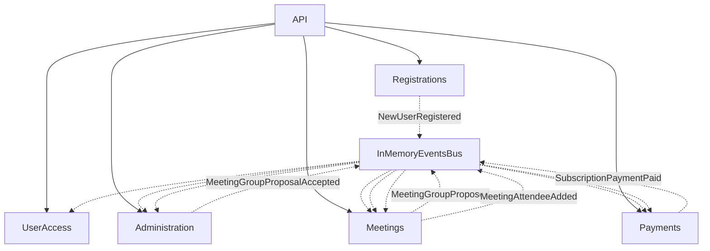

# Context map

Contexts, relationships, and shared rules. Ubiquitous language per context: `src/modules/*/CONTEXT.md`.

Architecture notes: [`docs/architecture/unit-of-work.md`](docs/architecture/unit-of-work.md), [`docs/architecture/outbox-inbox-internal-commands.md`](docs/architecture/outbox-inbox-internal-commands.md).

## Contexts

| Context | Schema | Glossary |
|---------|--------|----------|
| **User Access** | `users` | [`src/modules/user-access/CONTEXT.md`](src/modules/user-access/CONTEXT.md) |
| **Registrations** | `registrations` | [`src/modules/registrations/CONTEXT.md`](src/modules/registrations/CONTEXT.md) |
| **Administration** | `administration` | [`src/modules/administration/CONTEXT.md`](src/modules/administration/CONTEXT.md) |
| **Meetings** | `meetings` | [`src/modules/meetings/CONTEXT.md`](src/modules/meetings/CONTEXT.md) |
| **Payments** | `payments` | [`src/modules/payments/CONTEXT.md`](src/modules/payments/CONTEXT.md) |

## Relationships

Solid = in-process via module **facade** (`executeCommand` / `executeQuery`). Dashed = async **integration events** (Outbox → InMemoryEventsBus → Inbox → InternalCommand).

| Flow | Producer → consumers | Event |
|------|----------------------|-------|
| New user | Registrations → User Access, Administration, Meetings, Payments | `NewUserRegisteredIntegrationEvent` |
| Group proposal | Meetings → Administration | `MeetingGroupProposedIntegrationEvent` |
| Proposal accepted | Administration → Meetings | `MeetingGroupProposalAcceptedIntegrationEvent` |
| Paid attendee | Meetings → Payments | `MeetingAttendeeAddedIntegrationEvent` |
| Subscription paid | Payments → Meetings | `SubscriptionPaymentPaidIntegrationEvent` |

## Shared rules

- Cross-module **sync** goes only through the public facade. Direct imports of another module's domain, application handlers, or repositories are forbidden (see `dependency-cruiser`).
- Cross-module **async** uses integration events stored in the producer schema's Outbox, published on the in-memory bus, stored in the consumer Inbox, then executed as Internal Commands.
- Each bounded context writes only its own PostgreSQL schema.
- Authorization is **permission**-based on controllers (`HasPermission`), not Role checks in the domain.
- Domain stays persistence-ignorant (no ORM decorators). Writes use repositories + Unit of Work; reads use SQL views.
- Canonical terms from each context's `CONTEXT.md` apply at boundaries; consumers map payloads into their own language (e.g. registration → **User**, **Member**, or **Payer**).
